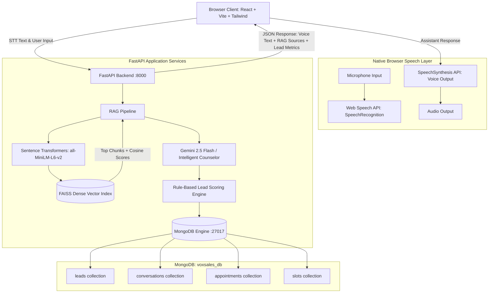

# VoxSales AI – One-Page Project Report & Technical Evaluation Document

**Project Name:** VoxSales AI – Autonomous AI Sales Voice Agent (Functional MVP)  
**Target Domain:** Online Technical Education (Fortivex Education)  
**Evaluation Track:** College Placement Technical Evaluation  
**Author:** Engineering Team  

---

## 1. Executive Summary & Business Problem

Online higher-education academies face significant conversion drop-offs during inbound discovery:
- **Delayed Counselor Response:** High-intent student leads submitting web inquiry forms often wait 4 to 24 hours for counselor follow-up, during which interest decays by up to 60%.
- **High Counselor Overhead:** Human admission counselors spend 70% of their bandwidth repeating standard syllabus, pricing, and prerequisites details rather than closing serious candidates.
- **Inconsistent Qualification:** Human counselors lack standardized lead qualification criteria, resulting in misrouted sales follow-ups and unbooked slots.

**Proposed Solution:**
**VoxSales AI** provides an autonomous, zero-latency 24/7 sales voice agent. Prospective students can verbally or textually ask questions about courses. The agent retrieves verified curriculum facts using **Sentence Transformers + FAISS vector RAG**, provides contextual guidance powered by **Gemini**, calculates a transparent **rule-based lead score (0–100)** in real time, saves lead profiles into **MongoDB**, and directly schedules 1-on-1 counseling appointments without human delays.

---

## 2. System Architecture



---

## 3. Database Collections Specification (`voxsales_db`)

| Collection | Key Fields & Types | Purpose & Indexes |
| :--- | :--- | :--- |
| **`leads`** | `name` (str), `email` (str), `phone` (str), `interested_course` (str), `lead_score` (int 0–100), `lead_category` ("Hot"\|"Warm"\|"Cold"), `sentiment` (str), `notes` (str), `created_at` (datetime) | Stores prospect profiles; Indexed on `email`, `phone`, `created_at` for high-throughput searches. |
| **`conversations`** | `session_id` (str), `lead_id` (ObjectId), `messages` (array of turns with role, content, timestamp), `last_message` (str), `lead_score` (int), `lead_category` (str), `created_at` (datetime) | Full conversation session transcripts; Unique index on `session_id`. |
| **`appointments`** | `customer_name` (str), `email` (str), `phone` (str), `course` (str), `slot_date` (YYYY-MM-DD), `slot_time` (HH:MM AM/PM), `status` ("Confirmed"), `created_at` (datetime) | Confirmed bookings; Compound unique index on `(slot_date, slot_time)` to strictly prevent double-booking. |
| **`slots`** | `slot_date` (str), `slot_time` (str), `is_booked` (bool), `booked_by` (str), `created_at` (datetime) | 30-minute academic consultation windows seeded for upcoming 5 days; Compound unique index on `(slot_date, slot_time)`. |

---

## 4. API Endpoints Documentation

| Method | Endpoint | Description | Request / Query Parameters | Key Response Output |
| :--- | :--- | :--- | :--- | :--- |
| **POST** | `/api/agent/interact` | Autonomous dialog turn | `{ session_id, message, mode }` | `{ reply, lead, lead_score, lead_category, sentiment, rag_sources, transcript }` |
| **GET** | `/api/dashboard/stats` | Live SaaS dashboard metrics | None | `{ total_leads, hot_leads, warm_leads, cold_leads, total_appointments, activity_timeline, course_distribution }` |
| **GET** | `/api/leads` | Filterable lead pipeline | `search`, `category`, `course`, `limit`, `skip` | `{ total, leads: [...] }` |
| **POST** | `/api/leads` | Create manual candidate | `{ name, email, phone, interested_course, notes }` | Created lead document with computed score |
| **PUT** | `/api/leads/{id}` | Update candidate details | Lead fields to modify | Updated lead document |
| **DELETE** | `/api/leads/{id}` | Delete lead | Path: `id` | `{ success: true }` |
| **GET** | `/api/appointments/slots` | Available/booked slots | None | `{ slots: [...] }` |
| **POST** | `/api/appointments/book` | Schedule appointment | `{ customer_name, email, phone, course, slot_date, slot_time, notes }` | `{ success: true, message, appointment }` (or `409 Conflict`) |
| **GET** | `/api/appointments` | Confirmed bookings list | None | `{ appointments: [...] }` |
| **GET** | `/api/knowledge/chunks` | Chunks metadata in FAISS | None | `{ total_chunks, embedding_model, vector_dimension, chunks }` |
| **POST** | `/api/knowledge/search` | Test FAISS vector search | `{ query, top_k }` | `{ latency_ms, retrieved_count, results: [ { course, score, content } ] }` |
| **GET** | `/api/health` | Service health monitor | None | `{ status: "healthy", mongodb: "connected", rag_chunks: 7 }` |

---

## 5. Transparent Rule-Based Lead Scoring Rubric

Lead score is deterministically calculated between 0 and 100 to ensure explainability during technical evaluation:

$$\text{Lead Score} = \text{Base} + S_{\text{contact}} + S_{\text{course}} + S_{\text{buying}} + S_{\text{booking}}$$

1. **Base Engagement:** +10 points (candidate initiated conversation).
2. **Phone Number Captured:** +25 points (high intent indicator).
3. **Email Address Captured:** +20 points.
4. **Candidate Name Provided:** +10 points.
5. **Specific Course Selected:** +20 points (Python, Java, Full Stack, AI, or DSA).
6. **Buying Signals in Chat:** +15 points (inquiries mentioning fee, discount, EMI, scholarship, placement, syllabus, batch timing).
7. **Appointment Booked:** +20 points (confirmed slot in MongoDB).

**Category Thresholds:**
- **Hot Lead ($\ge 70$ points):** High intent prospect with verified contact info, ready for immediate mentor consultation.
- **Warm Lead ($40 - 69$ points):** Interested prospect with course interest but partial contact details.
- **Cold Lead ($< 40$ points):** Casual browser inquiring generally without sharing contact data.

---

## 6. Commercial Feasibility & Operating Cost Analysis

### Key Assumptions (Production Scale)
- Monthly Active Users (MAU): 15,000 visitors.
- Average Conversation Length: 4 turns per session.
- Tokens per turn: 400 prompt tokens (includes RAG context), 120 completion tokens.
- Total Monthly LLM Calls: $15,000 \times 4 = 60,000$ calls.
- Total Prompt Tokens: $60,000 \times 400 = 24,000,000$ (24M tokens).
- Total Completion Tokens: $60,000 \times 120 = 7,200,000$ (7.2M tokens).

### Estimated Monthly Operational Costs (USD)
| Resource / Service | Unit Pricing | Monthly Volume | Total Cost (USD) |
| :--- | :--- | :--- | :--- |
| **Gemini 2.5 Flash API** | \$0.075 / 1M prompt tokens; \$0.30 / 1M output tokens | 24M input + 7.2M output | **\$3.96 / month** |
| **Speech STT & TTS** | Client-Side Browser Native Web Speech API | Unlimited | **\$0.00** (Free) |
| **Application Server** | Cloud VM (2 vCPU, 4GB RAM e.g. AWS t4g.medium / DigitalOcean) | 1 Instance | **\$18.00 / month** |
| **MongoDB Atlas** | M10 Dedicated Tier (10GB storage, replica set) | 1 Cluster | **\$49.00 / month** |
| **Bandwidth & CDN** | Cloudflare Free Tier / AWS CloudFront | ~50GB transfer | **\$2.00 / month** |
| **TOTAL ESTIMATED COST** | — | **~15,000 users** | **~\$73.00 / month** |

**Cost per Qualified Lead:** Less than **\$0.015 per lead**, compared to traditional telecaller BPO costs averaging **\$4.00 – \$7.00 per qualified lead**—representing a **>99% cost reduction** with instant response times.

---

## 7. Security Architecture

1. **Zero Frontend Secret Exposure:** The frontend never handles the `GEMINI_API_KEY` or MongoDB connection strings. All external model and database communications are strictly mediated by backend FastAPI controllers.
2. **Environment Isolation:** Secrets are managed via backend `.env` files and `.gitignore`. An `.env.example` template is provided for deployments.
3. **Input Sanitization & Pydantic Validation:** All incoming payloads (`message`, `email`, `phone`, `slot_date`, `slot_time`) are strictly validated using typed Pydantic models with bounded lengths and regex checks.
4. **Rate Limiting & Admin Protection:** Admin endpoints (direct deletions) require API secret authentication (`ADMIN_SECRET_KEY`).
5. **No Hallucination Boundary:** The AI counselor prompt is constrained by RAG context boundaries and instructed not to fabricate fees, discounts, or schedules.

---

## 8. Scalability Strategy for 100,000 Registered Users

### Registered Users vs. Concurrent Users
- **100,000 Registered Users:** Represents the total persistent user profiles, lead records, and booking histories stored in MongoDB.
- **Concurrent Active Users (Peak):** Standard industry concurrency ratio for educational platforms is ~1.5% to 3%. For 100,000 registered users, peak concurrent users are estimated at **1,500 to 3,000 concurrent active voice sessions**.

```
100,000 Registered Users  ──>  ~15,000 Daily Active Users  ──>  1,500 - 3,000 Peak Concurrent Sessions
```

### Architectural Scalability Roadmap
1. **Stateless FastAPI Workers:** Containerize the FastAPI backend via Docker. Deploy across an Amazon ECS or Kubernetes cluster behind an AWS Application Load Balancer (ALB). Since session state is persisted in MongoDB, any container instance can handle any user request.
2. **MongoDB Replica Set & Indexing:** 
   - Deploy a 3-node MongoDB Replica Set (1 Primary, 2 Secondaries) with automated failover.
   - 100,000 leads require approximately **120 MB to 200 MB** of data storage, fitting entirely in RAM (working set cache).
   - Read queries for dashboard aggregations can be offloaded to Secondary replica nodes (`readPreference: secondaryPreferred`).
3. **In-Memory Caching with Redis:**
   - Cache dashboard KPI statistics with a 30-second TTL to avoid recalculating counts across 100,000 documents on every request.
   - Cache frequent FAISS query vectors.
4. **Precomputed FAISS Indexes:**
   - Store the serialized FAISS index in persistent memory (`faiss.write_index`) to ensure zero recomputation overhead across horizontal worker spin-ups.

---

## 9. Future Scope & Roadmap

1. **Multilingual Speech & Regional Language Support:**
   - Expand beyond English to include Hindi, Hinglish, Tamil, and Telugu using Whisper API / Bhashini STT combined with regional text-to-speech models, enabling outreach to Tier-2 and Tier-3 college graduates.
2. **Conversational Long-Term Episodic Memory:**
   - Implement vector-based student memory (e.g. LangChain Zep or MongoDB Vector Search) to remember candidate background across multiple visits (e.g. "Welcome back Rahul! Last week you inquired about our Python weekend batch").
3. **Omnichannel CRM Integration:**
   - Direct webhooks into Salesforce, HubSpot, or Zoho CRM to trigger instant WhatsApp confirmation messages and Google Calendar calendar invites upon appointment booking.
4. **Live Human Counselor Hand-Off:**
   - Websocket-based real-time notification to human admission managers when a lead scores 90+ ("Ultra Hot"), allowing instant 1-click human takeover.
